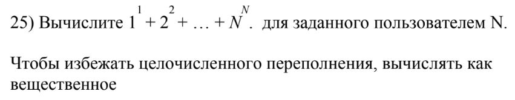
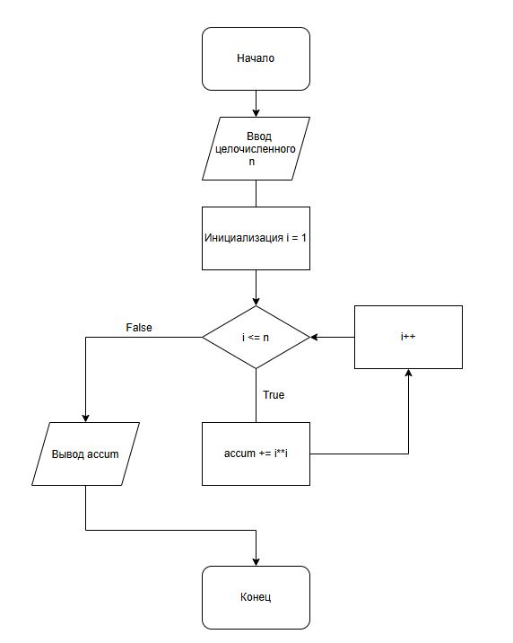

# Домашнее задание к работе 8
____

## Условие задачи
____

## 1. Блок-схема
____

 [Ссылка на блок-схему](https://app.diagrams.net/#G1PS1Ykxs2FVydRIsYQ-t9IsPUIojJdvpP#%7B%22pageId%22%3A%22p8k5OagdVle5MN2VutB9%22%7D)

## 2. Информация о разработчике

**Терентьев Максим**
**бТИИ-262**
